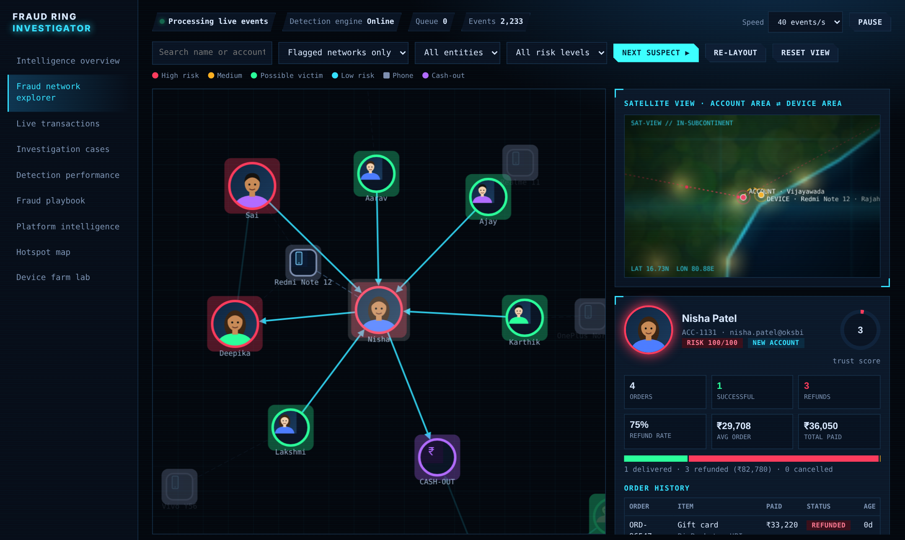
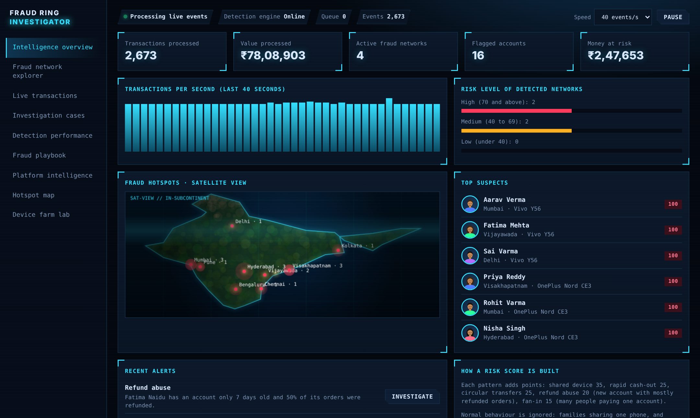
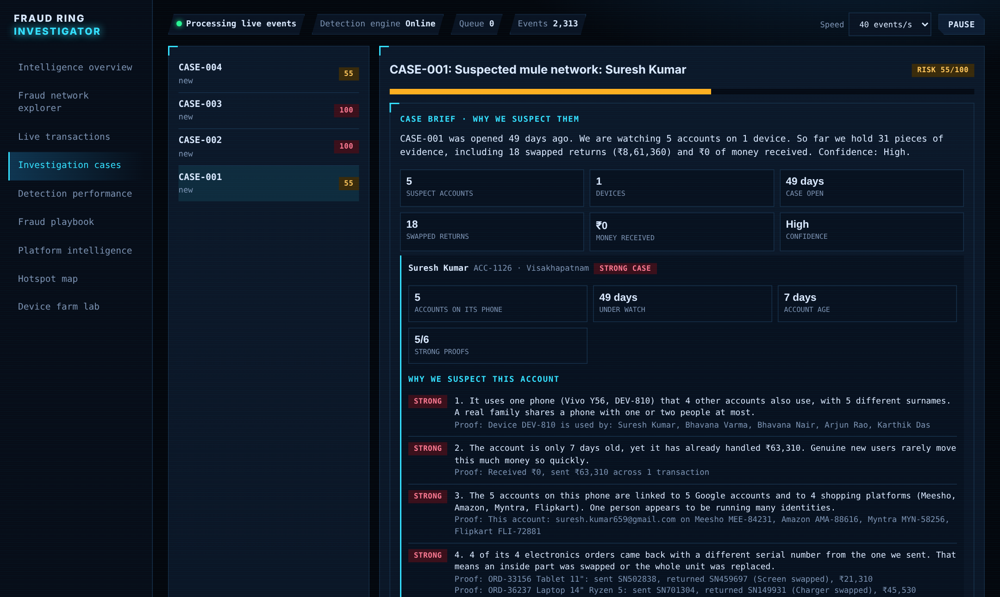
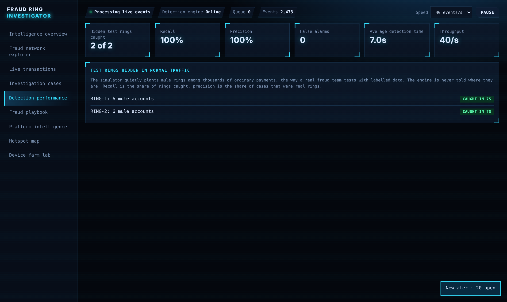
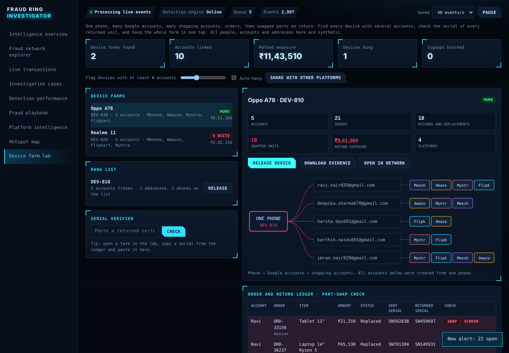

# 🕵️ Fraud Ring Investigator

> **Catch mule rings and device farms in seconds, not weeks.** A zero-dependency Java detection engine + REST API + a live investigation dashboard for Indian e-commerce and UPI payment fraud. Everything runs on synthetic data, so it is safe to explore, fork and demo.

[](https://github.com/REPLACE-WITH-YOUR-USERNAME/fraud-ring-investigator/actions)


**[▶ Live demo](https://fraud-tracenet.vercel.app/)** · [Dashboard](https://fraud-tracenet.vercel.app/dashboard.html) · [Report](https://fraud-tracenet.vercel.app/report.html) · [Cases](https://fraud-tracenet.vercel.app/case-studies/) · [Slides](https://fraud-tracenet.vercel.app/Fraud_Ring_Investigator.pptx) · [API docs](https://fraud-tracenet.vercel.app/api.html) · [Architecture](https://fraud-tracenet.vercel.app/architecture.html)



---

## Why this exists

A single stolen payment is easy to spot. A **ring** is not. Five victims each send a normal-looking amount to one account, that account passes money around a loop of other accounts, and an ATM withdrawal empties it, all in about ten seconds. Every transaction on its own looks fine. **The shape of the money is the giveaway**, so this project judges the *network*, not the single payment.

It also tackles the other half of e-commerce abuse: **device farms**, where one phone hosts many accounts that order high-value electronics and then return swapped parts.

## What it detects

| Pattern | What the engine sees | Points |
|---|---|---|
| **Shared device network** | 3+ accounts with *different surnames* sending money from one phone | 35 |
| **Rapid cash-out** | ≥ 80% of an inflow of ₹50,000+ leaves again within seconds | 25 |
| **Circular transfers** | Money returning to its origin through 3–4 accounts (hops ≥ ₹10,000), found with a DFS cycle search | 25 |
| **Fan-in** | 4+ different people paying one account ≥ ₹50,000 (average ≥ ₹8,000) in a minute | 15 |

Alerts that touch the same account or phone are **merged into one case**. The score is the sum of the *distinct* patterns (max 100): **70+ High, 40–69 Medium, below 40 Low**, and every point is shown with its evidence.

**Built to avoid false alarms**, and each rule below has a unit test:
- Relatives sharing one phone (same surname) are ignored
- Shoppers paying Flipkart, Myntra or Swiggy are ignored
- Small friendly loops under ₹10,000 and two-person ping-pong are ignored
- Many *small* payments that merely add up in a busy minute are ignored (found by benchmarking, see the [report](https://fraud-tracenet.vercel.app/report.html))

**Device-farm lab:** find phones with many accounts, verify returned serial numbers against dispatched ones, *hang* (freeze) a whole farm in one call, gate new signups (`ALLOWED / REVIEW / BLOCKED`), and export an evidence report.

## Results

Benchmark: **100 random seeds × 300 simulated seconds**, normal traffic with hidden planted fraud (mule rings and device farms):

| Metric | 5 events/s | 40 events/s (busy) |
|---|---|---|
| Fraud groups planted → caught | 1,629 → **1,629** | 1,618 → **1,618** |
| Recall | **100%** | **100%** |
| Precision (cases that were real) | **100%** | **100%** |
| False alarms | **0** | **0** |
| Average time to flag | **3.8 s** after it starts | **3.8 s** |
| Throughput | ~38k events/s | ~112k events/s |

Plus a test that runs **20 seeds of normal traffic with nothing planted and requires zero cases**.

> ⚠️ **Read this honestly.** The simulator plants the same patterns the detector looks for, so these numbers show the engine works *as designed*, not that it would score 100% on real bank data. Real fraud is adaptive and messy. See [Limitations](#limitations).

## Quick start

You only need a **JDK 17+**. No Maven, no Gradle, no downloads.

```bash
git clone https://github.com/REPLACE-WITH-YOUR-USERNAME/fraud-ring-investigator.git
cd fraud-ring-investigator
./scripts/run.sh                 # compile + 26 tests + demo
```

```bash
java -jar build/fraud-ring-investigator.jar demo  --seed 7 --seconds 120   # cases with evidence
java -jar build/fraud-ring-investigator.jar bench --runs 100 --rate 40      # recall / precision
java -jar build/fraud-ring-investigator.jar farm  --seed 5 --seconds 150    # device-farm evidence report
java -jar build/fraud-ring-investigator.jar serve --port 8080               # live REST API
```

Sample output:

```
CASE-002  risk 100 HIGH   Suspected mule network: Lakshmi Chowdary
    +35 Shared device network: 3 unrelated accounts (Lakshmi Chowdary, Fatima Varma, Deepika Gupta) all send money from one phone, a iPhone 13.
    +25 Rapid cash-out: Lakshmi Chowdary received INR 144,892 and moved INR 140,546 out within seconds.
    +25 Circular transfers: Money moved in a loop: Lakshmi Chowdary -> Fatima Varma -> Deepika Gupta -> Lakshmi Chowdary.
    +15 Fan-in pattern: 4 different people paid Lakshmi Chowdary a combined INR 99,139 within a minute.
```

**Docker:** `docker build -t fraud-ring . && docker run -p 8080:8080 fraud-ring` then open `http://localhost:8080/api/summary`
**Dashboard:** open `docs/dashboard.html` in any browser, no server needed. (`docs/index.html` is the project home page.)

## Screenshots

| Overview | Investigation cases |
|---|---|
|  |  |
| **Detection performance** | **Device-farm lab** |
|  |  |

## How it works

```
World (synthetic) ──► payments, 1 second at a time ──► DetectionEngine ──► CaseBook ──► FraudCase (score + evidence)
 normal traffic + hidden                                4 pattern checks      merges by shared account/phone
 planted rings & farms                                                                 │
        └──────── ground-truth labels (hidden from the engine) ──► Performance          └──► DeviceFarmLab ──► hang / gate / serial check
                                                                   recall, precision, speed        └──► ApiServer (REST, JDK built-in)
```

Full walkthrough in [Architecture](https://fraud-tracenet.vercel.app/architecture.html).

## Project layout

```
src/main/java/com/frauddetect/   engine, model, device lab, REST API, CLI  (16 small files)
src/test/java/com/frauddetect/   26 tests, zero-dependency runner
docs/                            site: index.html (home), dashboard.html, report, case studies, slides, API, architecture
deploy/                          Render blueprint
scripts/                         build.sh (build + test + jar), run.sh, build_site.py (Markdown → HTML docs)
.github/workflows/               CI, Pages deploy, jar release
```

## Deploy it

**Vercel (website, easiest):** import the repo at [vercel.com/new](https://vercel.com/new). `vercel.json` already sets the output folder to `docs/`, so just click Deploy. Vercel hosts the static site only (home page, dashboard, report, case studies, slides); the Java API needs a Docker host such as Render (step 2 below).


1. **Dashboard:** push to GitHub → **Settings → Pages → Source: GitHub Actions**. The `pages.yml` workflow publishes `docs/` as your live demo.
2. **API:** `deploy/render.yaml` deploys the Docker image on Render (free tier) with a health check at `/api/health`.
3. **Release:** `git tag v1.0.0 && git push --tags` and `release.yml` attaches the jar.

## Limitations

Being upfront is part of the project:

- **Synthetic data only.** Fraudsters adapt: they slow down, split amounts and rotate phones.
- **Self-confirming benchmark.** Planted fraud matches the detector's rules, so recall is optimistic.
- **Thresholds are hand-set** (₹10,000 hops, 4 senders, 80% cash-out, ₹8,000 average) and need tuning per business.
- **A score is a lead, not proof.** A human must review before any account is frozen.
- The dashboard also shows *refund abuse*; the Java engine implements the four patterns above plus the device-farm lab.

## Roadmap

- [ ] CSV / database input
- [ ] Refund-abuse and promo-abuse rules in Java
- [ ] Threshold tuning from labelled data
- [ ] Graph-ML scoring (community detection) next to the rules
- [ ] JUnit 5 migration (kept dependency-free for now)

## The story behind it

What we tried, what failed, what it fixed and what inspired it: read the **[project report](https://fraud-tracenet.vercel.app/report.html)** and the **[case studies](https://fraud-tracenet.vercel.app/case-studies/)**.

## Responsible use

Synthetic data only. Never commit real customer data. See [SECURITY.md](SECURITY.md). If you suspect real fraud in India, report it at [cybercrime.gov.in](https://cybercrime.gov.in) or call **1930**.

## Contributing & license

PRs welcome, see [CONTRIBUTING.md](CONTRIBUTING.md). MIT licensed.

⭐ If this helped or inspired you, a star helps others find it.
